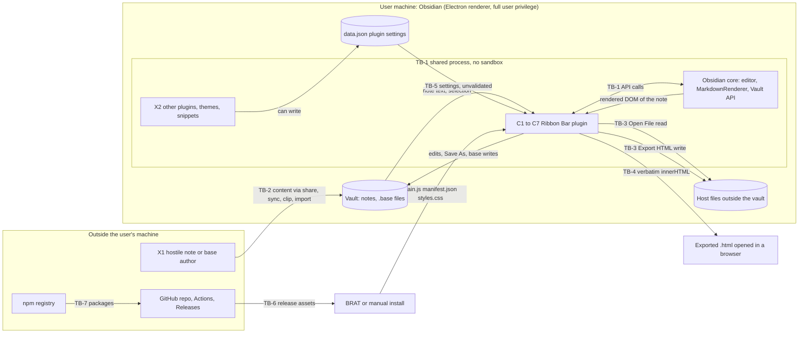

# Ribbon Bar — Threat Model

| | |
|---|---|
| **Method** | STRIDE per component and trust boundary, backed by an active threat hunt (every "Confirmed" finding was exercised with a working proof of concept and controls in the run that produced this document) |
| **Version reviewed** | `ribbon-bar` 0.18.8 (`manifest.json` / `package.json`) |
| **CODE_PIN** | `57fa133474f2b0ed44bd31ce6313b5fcdba6f585` (`master`, "chore: update version to 0.18.8 (#35)"). All `file:line` citations refer to this commit. |
| **Date** | 2026-10-25 |
| **Mode** | CREATE (no earlier model existed) |
| **Status** | Draft for maintainer review. Not yet merged. |
| **Test environment** | Linux 6.18.44 x86_64 sandbox. Node v24.22.1 / npm 11.19.1 (the version `.nvmrc` pins is `24`) for install, tests, build and every Vitest PoC; Vitest 5.0.5; jsdom 30.1.3; `yaml` 2.9.1 (the test stand-in for Obsidian's YAML functions); Playwright 1.63.0 with Chromium 153.0.8010.12 (run under the sandbox's Node v22.22.0). **Obsidian itself was not available**, so everything that depends on real Obsidian/Electron behaviour is an assumption (section 2.5), not a result. |

---

## 1. How to use this document

### 1.1 Purpose

Ribbon Bar is a desktop-only Obsidian plugin that docks an Office-style ribbon above Markdown panes and edits notes, frontmatter, tables and Obsidian Bases files. This document records what could go wrong, what was actually demonstrated, what already protects the user, and what to fix first. Read it **before** changing anything in the table below.

### 1.2 When you must update it

Re-read the document, and update it if the change matches a row, in the same PR.

| Change type | Why it triggers a re-read | Look at |
|---|---|---|
| New or changed DOM/HTML sink (`innerHTML`, `{@html}`, `insertAdjacentHTML`, `srcdoc`, `MarkdownRenderer` output copied elsewhere) | Plugin runs un-sandboxed in the Obsidian renderer (E-1) | T-4, V-4, V-8 |
| New outbound network request, `fetch`, `requestUrl`, WebSocket, image/link prefetch | Today the plugin has none (V-1) | I-1, I-3, V-1 |
| New file-system capability: any `vault.create/modify/process/rename/delete`, `adapter.*`, `fs`, native file dialog, drag-and-drop import | Paths and contents come from notes or the user | T-2, T-3, T-6, D-5, V-6, V-7 |
| New text transform, regex or parser over note content, selection or settings | Super-linear time on hostile notes (V-9) | D-1…D-4 |
| New persisted data (`saveData`, new keys in `data.json`, files in the vault) | Settings are trusted without validation (V-10) | T-1, T-8, I-2 |
| New launch/open capability: `executeCommandById`, `window.open`, `shell.openExternal`, URL/protocol handlers | Core command ids can be shadowed (S-2) | S-2, E-1 |
| New interpolation of strings into YAML, Markdown syntax, `style=` or HTML | Injection into the note or exported file | T-1, T-5, V-5 |
| Any change to `.github/workflows/*`, `esbuild.config.mjs`, release scripts, `dependabot.yml`, branch rules | Build/release boundary (TB-6) | E-2…E-5, T-9, RP-2, V-11, V-12 |
| New dependency, or an upgrade that adds install scripts, native code, or something that ends up in `main.js` | Supply chain (TB-7) | E-7, section 5.4 |
| Relaxing or removing any control in section 6 | Controls are listed because something relies on them | section 6, section 7 |
| Adding mobile support (`isDesktopOnly` → false) or any Node/Electron API use | Different privilege and storage model | E-1, AS-6 |

Add one line to every PR description: `Threat model: no impact` or `Threat model: updated (T-1, V-5)`. After a change that matches the table, a second engineer re-runs the PoC registry (section 9) against the new commit and appends a row to section 11.

### 1.3 Rating scale

Rating = likelihood × impact. When impact is high but an attacker precondition is required, the rating says so.

| Rating | Meaning |
|---|---|
| **Critical** | Attacker needs no real precondition and gets code execution, silent data theft, or a compromised release shipped to users. |
| **High** | Same impact class, but needs one plausible precondition (e.g. victim opens a crafted note and performs one routine click), or low impact reachable with no precondition at scale. |
| **Medium** | Significant but bounded harm (user-visible hang of the app, tampering with shared output, release pipeline exposure) that needs a crafted input and a deliberate user action, or a CI weakness whose exploitation needs another compromise first. |
| **Low** | Local, self-inflicted, recoverable, or requires write access that already implies a larger compromise. |
| **Info** | Hygiene; no demonstrated harm. |

### 1.4 Status vocabulary

| Status | Meaning |
|---|---|
| **Confirmed** | Reproduced in the run that produced this document, with a working PoC (section 9). |
| **Reasoned** | Found by reading code or configuration. Not exercised. |
| **Mitigated** | A control exists and was checked to work. |
| **Accepted** | Inherited from the platform, or a deliberate trade-off (the decision-maker is named). |
| **Disproved** | A hypothesis that was tested and did not hold. Kept on purpose (section 5.3). |

Where a finding is "Confirmed" for the plugin's own behaviour but its real-world effect depends on Obsidian's behaviour, the row says so and lists the AS-n it depends on.

ID conventions: `A#` assets, `X#` adversaries, `TB-#` trust boundaries, `C#` components, `AS-#` assumptions, `S-/T-/I-/D-/E-n` threats, **`RP-n` repudiation threats** (so they do not collide with `R-n` recommendations), `V-#` invariants, `R-#` recommendations, `N-#` notes, `PoC-#` experiments, `H-#` disproved hypotheses, `CL-#` claims.

---

## 2. System overview

### 2.1 What it is

An Obsidian community plugin (id `ribbon-bar`, `isDesktopOnly: true`, `minAppVersion` 1.14.0; `manifest.json:2-8`) built with TypeScript + Svelte 5, bundled by esbuild into one `main.js`. It is installed by copying `main.js`, `manifest.json`, `styles.css` into `<vault>/.obsidian/plugins/ribbon-bar/` — via the repo's install scripts or via the BRAT plugin pulling GitHub releases. Obsidian loads it **in-process with full user privileges** and no sandbox (E-1, AS-6).

Capabilities that matter for security:

* Text edits to the active note through Obsidian's editor API (formatting, lists, tables, callouts, links, LaTeX, Format Document). `src/ribbon/commands/actions/*.ts`.
* Frontmatter editing: predefined properties from `data.json` and an Add Property dialog. `frontmatter.ts`, `propertyEntry.ts`, `addProperty.ts`, `propertyModal.ts`.
* **File tab** (`file.ts`): New, Open (core command), **Open File** (system file picker → copy into vault), **Save As** (arbitrary vault path), Move/PDF (core commands), **Export HTML** (render note → standalone `.html` written outside the vault).
* **Bases tab** (`src/ribbon/bases/*`): parse, edit and rewrite `.base` YAML files and ```` ```base ```` blocks.
* Settings persisted via `loadData`/`saveData` to `.obsidian/plugins/ribbon-bar/data.json` (`main.ts:84-89`).

What it does **not** do (verified, V-1/V-3): no network requests, no child processes, no `eval`/`new Function`, no dynamic `require`, no Electron APIs, no `localStorage`. See PoC-12.

### 2.2 Assets

| ID | Asset | Why it matters |
|---|---|---|
| A1 | Note contents in the vault (confidentiality + integrity) | The product's whole purpose; the plugin rewrites notes and `.base` files. |
| A2 | Vault configuration and other plugins' code under `.obsidian/` | Writing there is equivalent to code execution in Obsidian (other plugins, snippets). |
| A3 | Availability of the Obsidian UI thread and unsaved edits | A renderer hang loses work. |
| A4 | Plugin settings (`data.json`) | Contains the predefined-property list that is later written into notes. No secrets (V-2). |
| A5 | Release artifacts (`main.js`, `manifest.json`, `styles.css`) | Executed with full user privilege by every user of the plugin. |
| A6 | Maintainer credentials and repo write access (`GITHUB_TOKEN`, maintainer account) | Controls A5. |
| A7 | Files on the host outside the vault | Reachable through Open File (read) and Export HTML (write). |

### 2.3 Adversaries

| ID | Adversary | Capability |
|---|---|---|
| X1 | Author of hostile content (note, `.base` file, web clipping, imported file) | Controls text that the victim opens, selects or formats. Typical vectors: shared vault, Obsidian Sync/Git sync, Web Clipper, downloaded `.md`. No code on the victim machine. |
| X2 | Co-resident code: another community plugin, theme, CSS snippet | Same process, same privileges. Can read/write `data.json`, shadow command ids, call the vault API. |
| X3 | Local process, other synced device, or sync service with vault write access | Can edit notes and `.obsidian/` files concurrently. |
| X4 | Compromised upstream: npm package, GitHub Action, Dependabot PR | Code runs in CI and/or in the bundle. |
| X5 | Malicious or compromised contributor / maintainer account | Can change source, workflows, releases. |
| X6 | Social engineer | Persuades the user to type a path, paste a config, or open an exported file. |
| X7 | Network attacker | No plugin network traffic exists (V-1); only relevant to the supply chain and to files fetched by Obsidian itself. |

Device thieves are out of scope: the plugin stores nothing sensitive and relies on the OS and Obsidian for disk protection.

### 2.4 Trust boundaries and data flow

| ID | Boundary |
|---|---|
| TB-1 | Plugin ↔ Obsidian core ↔ other plugins: one un-sandboxed renderer process (same-process-other-code). |
| TB-2 | Untrusted vault content (notes, `.base` files, frontmatter) → plugin text processing. |
| TB-3 | Plugin ↔ host file system through native dialogs (Open File, Export HTML save). |
| TB-4 | Exported `.html` → whichever browser/app opens it later (no Obsidian sanitisation context). |
| TB-5 | `data.json` in the vault config folder (may be synced, writable by X2/X3) → plugin. |
| TB-6 | Source → GitHub Actions → GitHub Release → BRAT/manual install → user's machine (build/release). |
| TB-7 | npm registry and third-party actions → build and bundle. |



### 2.5 Assumptions (things to verify; findings that depend on them)

| ID | Assumption (not verified in this run) | Depends on |
|---|---|---|
| AS-1 | Obsidian's `MarkdownRenderer` output has `<script>` and inline event handlers removed, but still contains remote ``/`<iframe>` and may keep unusual URL schemes. No Obsidian was available to test. | T-4, I-3 |
| AS-2 | Obsidian's `vault.create`/`createFolder` either reject or normalise `..`/absolute paths, and permit creating files under `.obsidian/`. | T-2, V-6 |
| AS-3 | Obsidian's `parseYaml`/`stringifyYaml` behave like the `yaml` package used by the repo's test stand-in (comment loss, `__proto__` as an own key). | T-7, H-1 |
| AS-4 | Plugin command ids are namespaced `<pluginId>:<commandId>`, so a community plugin whose id equals a core prefix (`switcher`, `file-explorer`, `workspace`) could define a colliding id. | S-2 |
| AS-5 | The rendered DOM of a note contains `app://…` URLs for local images/embeds. | I-4 |
| AS-6 | Community plugins run un-sandboxed with Node/Electron access, in the same renderer process as Obsidian and each other. | E-1, TB-1 |
| AS-7 | GitHub repository settings not readable with the available token: required reviews, rulesets, default `GITHUB_TOKEN` permissions, allowed actions, secret scanning. Only `protected: true` on `master` was observed (via the branches API), and `release/*` branches are unprotected. | E-2, E-4 |
| AS-8 | `window.showSaveFilePicker` exists in Obsidian's Electron; otherwise the download fallback is used (`file.ts:116-141`). | T-4 |
| AS-9 | Obsidian's modal dialogs block editor input; edits made while a Base dialog is open come from sync, other plugins or other devices. | T-6 |
| AS-10 | BRAT installs the assets of the GitHub release as-is without verifying a signature. | S-1, T-9 |

---

## 3. STRIDE matrix

Components:

| ID | Component | Main files |
|---|---|---|
| C1 | Plugin core and settings (load, settings tab, ribbon manager, palette commands) | `src/main.ts`, `src/settings.ts`, `src/settings-tab.ts`, `src/ribbon/RibbonManager.ts`, `paletteCommands.ts` |
| C2 | Ribbon UI (Svelte components, command registry) | `src/ribbon/components/*.svelte`, `commands/registry.ts`, `commands/definitions/*` |
| C3 | Text-editing actions (home/insert/layout/references/LaTeX/tables/Format Document) | `src/ribbon/commands/actions/*.ts` |
| C4 | Frontmatter and Properties | `frontmatter.ts`, `propertyEntry.ts`, `addProperty.ts`, `propertyModal.ts` |
| C5 | File tab (Open File, Save As, Export HTML, New) | `commands/actions/file.ts`, `fileText.ts` |
| C6 | Bases tools | `src/ribbon/bases/**` |
| C7 | Callout preview (renders typed Markdown) | `commands/actions/calloutModal.ts` |
| C8 | Build, CI and release pipeline | `.github/workflows/*`, `esbuild.config.mjs`, `scripts/*`, `dependabot.yml` |
| C9 | Dependencies and the shipped bundle | `package.json`, `package-lock.json`, `main.js` |

| Component | S | T | RP | I | D | E |
|---|---|---|---|---|---|---|
| C1 | S-2 | T-8 | RP-1 | I-1, I-2 | — | E-1 |
| C2 | — | — | — | — | — | E-6 |
| C3 | — | T-5 | — | — | D-1, D-2, D-4 | — |
| C4 | — | T-1, T-5 | RP-1 | — | — | — |
| C5 | S-2 | T-2, T-3, T-4 | RP-1 | I-3, I-4 | D-5 | E-1 |
| C6 | — | T-6, T-7 | RP-1 | — | D-3 | — |
| C7 | — | — | — | — | — | — |
| C8 | S-1 | T-9 | RP-2 | I-5 | — | E-2, E-3, E-4, E-5 |
| C9 | — | — | — | — | — | E-7 |

C7 was examined (callout preview renders only text the user typed, with `sourcePath` `""`, `calloutModal.ts:80`) and produced no threat that is not already covered by AS-1; it stays in the matrix so a future change to it is visible.

---

## 4. Findings

Findings are ordered by rating (Medium first, then Low), Confirmed before Reasoned within a rating; the accepted platform risk E-1 closes the section. Every `file:line` is at CODE_PIN. PoC numbers refer to section 9.

### D-1 Format Document hangs the app on a crafted note (quadratic regex)

| | |
|---|---|
| **Rating** | **Medium** (likelihood: needs a crafted note *and* the user running *File/Layout → Format Document*; impact: renderer hang, possible loss of unsaved work) |
| **STRIDE** | Denial of service |
| **Status** | **Confirmed** (PoC-1) |
| **Where** | `src/ribbon/commands/actions/formatMarkdown.ts:68` (`line.match(/[ \t]*$/)` in `trimTrailingWhitespace`) and `:57` (`rest.replace(/\s+#+\s*$/, "")` in `stripHeadingTrailingHashes`); reached from `layout.ts:100-106` (`formatDocument` → `formatMarkdown`) and the "Format Document" command (`definitions/layout.ts:67`) |

**What happens.** Both patterns are unanchored at the start and scan to the end of the run of whitespace from every start position. A single line that contains a long run of spaces/tabs followed by a non-space character costs O(n²). Format Document applies the transform to every line outside code fences, on the whole note, synchronously on the UI thread.

**Who / impact.** X1 puts a line such as `a` + 160 000 spaces + `x` into a note the victim receives (shared vault, clipping, imported file, sync). When the victim runs Format Document, Obsidian's renderer is blocked for the duration. Observed: **21–26 s at 160 KB**; time quadruples per doubling. Extrapolated (not run): ~14 minutes at 1 MB. Obsidian must be force-quit; unsaved edits in any other pane are at risk. The effect is local and recoverable, which is why this is Medium rather than High.

**Evidence (PoC-1, Node 24.22.1, best of 3, ms).**

| line length n | `trimTrailingWhitespace` | `stripHeadingTrailingHashes` | `formatMarkdown` end-to-end |
|---|---|---|---|
| 20 000 | 327.9 | 355.6 | 285.4 |
| 40 000 | 1 303.4 | 1 479.8 | 1 154.2 |
| 80 000 | 5 360.9 | 6 084.1 | 4 990.6 |
| 160 000 | 21 464.3 | 26 164.7 | 22 943.7 |
| **control** (`a`×n + `x`, same functions) | 0.1 → 0.9 | 0 → 0.4 | — |

The control (same length, no whitespace run) stays linear (≤ 0.9 ms), so the harness is measuring the regex, not the input size.

**Recommendation.** R-1.

### T-4 Export HTML writes the renderer's DOM verbatim; no sanitiser, no CSP

| | |
|---|---|
| **Rating** | **Medium** (impact high if Obsidian passes active content through; precondition: attacker note + user exports and shares/opens the file; platform behaviour unverified, AS-1) |
| **STRIDE** | Tampering / Elevation of privilege (in the browser that opens the file) |
| **Status** | **Reasoned** for the attack chain. **Confirmed** sub-claims: (a) the plugin passes the renderer output through untouched and adds no CSP (PoC-5); (b) a document containing such markup *does* execute script, load remote resources and run `javascript:` links when opened from `file://` in Chromium 153 (PoC-6). What is **not** confirmed is whether real Obsidian ever hands such markup to the exporter (AS-1). |
| **Where** | `src/ribbon/commands/actions/file.ts:151` (`MarkdownRenderer.render`), `:154` (`container.innerHTML` → `buildHtmlDocument`), `fileText.ts:52-65` (template: no `<meta http-equiv="Content-Security-Policy">`), `file.ts:116-141` (`saveWithDialog` writes the file) |

**What happens.** Export HTML renders the note into a detached `<div>` and writes `container.innerHTML` into a standalone page. The only escaping is of the `<title>` (`fileText.ts:57`; verified, H-4). The exported file leaves Obsidian's sanitising and CSP context (TB-4) and is later opened by a browser, a mail client, or sent to colleagues.

**Who / impact.** X1 authors a note (or a note embedded by `![[...]]`) whose rendered form keeps remote ``/`<iframe>` (Obsidian renders remote images and iframes in notes — AS-1) or, if the platform sanitiser has a gap, script/handlers/`javascript:` URLs. After export, opening the `.html` from disk contacts attacker hosts (tracking, IP disclosure) and, in the gap case, runs script with `file://` origin. The consequence side was demonstrated with synthetic markup in a real Chromium: positive control (remote `` + `<script>`) produced a request and ran script; negative control (benign page) produced neither; the exported document produced requests to `/beacon.png` and `/frame`, set `window.__pwn`, and a click on the `javascript:` link raised a dialog.

**Recommendation.** R-3 (sanitise on export with an allowlist, add a restrictive CSP meta, strip event handlers and non-http(s)/mailto URLs, drop `<iframe>`/`<script>`/`<object>`), R-13 (document that the export is not sanitised).

### E-2 The release job runs install scripts while holding a write token

| | |
|---|---|
| **Rating** | **Medium** (high impact: a malicious dependency or compromised action could publish a tampered release to every user; needs a prior upstream compromise) |
| **STRIDE** | Elevation of privilege (supply chain) |
| **Status** | **Reasoned** |
| **Where** | `.github/workflows/release.yml:14-15` (`contents: write` for the whole job), `:17` (`actions/checkout@v7` with default `persist-credentials: true`, so the token stays in `.git/config`), `:24` (`npm ci` runs lifecycle scripts — `esbuild`'s `postinstall`, per the lockfile — with the write token present on disk), `:31` (`npm run build` executes the toolchain), `:34-44` (`gh release create`) |

**What happens.** Dependency install and the build run in the same job and step environment as the credential able to create releases and tags. Release is triggered by *any* push to `master` that changes `manifest.json` (`:3-8`). The checked-out token is not needed by the build.

**Impact.** A compromised install script or build plugin can use the persisted token to modify releases or tags, or can alter `main.js` before upload. Releases are the only path BRAT users take (AS-10).

**Mitigating context (observed):** `master` is protected (`protected: true`); the lockfile pins every package with an integrity hash and only registry URLs (194 of 194 checked in PoC-12); only four packages end up in the bundle (section 5.4).

**Recommendation.** R-8 (build job with `permissions: contents: read`, `persist-credentials: false`, `npm ci --ignore-scripts` where esbuild still works; separate release job with the write token that downloads the artifact; SHA-pin actions).

### T-9 Release assets are mutable, unsigned and unattested

| | |
|---|---|
| **Rating** | **Medium** (impact on all users; requires write access to the repo/release) |
| **STRIDE** | Tampering |
| **Status** | **Reasoned** (the *detectability* side is **Mitigated**: see below) |
| **Where** | `.github/workflows/release.yml:38-41`; observed release 0.18.8 metadata `"immutable": false`; no attestation step, no checksum file |

**What happens.** `gh release create` uploads three loose files. The release is not immutable, assets can be replaced by anyone with write access after publication, and nothing lets a user verify provenance. **Positive finding:** the published `main.js` digest `sha256:0330c5bea24f8c458cc5d3294d317470b041c82b791cda4875aeee7c38570e8b` is byte-identical to a fresh local build of the CODE_PIN on Node 24.22.1 (two local builds also matched each other), and the digests of `manifest.json` (`1e9f8ab2…`) and `styles.css` (`716a5b47…`) match the repo files. So the build is reproducible and an independent party *can* detect tampering — but only if someone looks (PoC-12).

**Recommendation.** R-9 (artifact attestation + `SHA256SUMS`, enable immutable releases).

### T-1 Frontmatter injection through predefined-property settings

| | |
|---|---|
| **Rating** | **Low** (needs write access to `data.json`, which in most setups already allows replacing `main.js`; relevant in setups that sync only settings, TB-5) |
| **STRIDE** | Tampering |
| **Status** | **Confirmed** (PoC-2) |
| **Where** | `src/ribbon/commands/actions/frontmatter.ts:55-80` (`formatValueLines`: `:65` list items, `:77` default branch interpolate `name` and `defaultValue` raw); inputs from `src/settings.ts:39-40` and `src/main.ts:84` (`loadData`); `src/settings-tab.ts:110` only `trim()`s a typed name |

**What happens.** The *Properties* menu inserts `${name}: ${defaultValue}` lines built from `data.json` without quoting or newline checks. A default value `x\n---\n[[evil]] \n---` closes the frontmatter and injects body text; a name `a: 1\ncssclasses: pwn` injects a second key. The *Add Property* dialog path (`propertyEntry.ts:72-109`) rejects line breaks in names and quotes values — it is the negative control and passed.

**Impact.** Tampered settings can plant links/embeds, `cssclasses`, or fake keys in notes when the user clicks a property in the menu. Settings in the UI cannot contain newlines (single-line inputs), so only a file-level writer (X2/X3, or a malicious shared `data.json`) can do this.

**Recommendation.** R-5 (reuse `yamlKey`/`yamlText` for predefined properties), R-6 (validate settings on load).

### T-6 Base edits are written back from a stale snapshot (lost update and wrong-block write)

| | |
|---|---|
| **Rating** | **Low** (needs a concurrent change to the same base; data loss, recoverable from Obsidian file recovery/sync history) |
| **STRIDE** | Tampering (integrity of A1) |
| **Status** | **Confirmed** (PoC-10) |
| **Where** | `src/ribbon/bases/target.ts:31-36` (inline `save` re-checks only that the fence still exists at the *old line number*), `:47-49` (file `save` ignores the current contents: `vault.process(file, () => …)`), `src/ribbon/bases/ui/BaseManagerModal.ts:109-116` |

**What happens.** The base dialog loads a snapshot, lets the user edit a copy, and on Save overwrites the target with the re-serialised copy. Nothing compares the current content with the loaded snapshot. PoC-10 shows: (a) a concurrent addition to a `.base` file is silently lost; (b) text typed into an inline block between load and save is lost; (c) **if lines are inserted above the block, `save` writes block C's YAML over block B**, because the fence check only asks "is there *a* base fence at the old index?". Case (c) of the stale-index class where the index falls past the end of the document is caught (H-6).

**Impact.** X3 (sync, another device, another plugin) or plain concurrency causes silent loss of base definitions. No confidentiality impact.

**Recommendation.** R-7.

### T-2 Save As builds a vault path from free text with no confinement

| | |
|---|---|
| **Rating** | **Low** (the typed path is the user's own; abuse needs social engineering, and the real effect depends on Obsidian's path handling, AS-2) |
| **STRIDE** | Tampering / Elevation of privilege |
| **Status** | **Confirmed** for the plugin's behaviour (PoC-3); platform effect **Reasoned** (AS-2) |
| **Where** | `src/ribbon/commands/actions/fileText.ts:36-40` (`normalizeSaveAsPath`: trims, strips leading `/`, appends `.md` if no extension), `src/ribbon/commands/actions/file.ts:93-104` (`createFolder` + `vault.create` with that path) |

**What happens.** `../../outside/x` becomes `../../outside/x.md`; `.obsidian/plugins/ribbon-bar/main.js` and `.obsidian/snippets/a.css` are accepted as-is (any extension is kept); Windows drive paths and backslashes are not rejected. The end-to-end run showed `createFolder("../../escape/.obsidian")` and `create("../../escape/.obsidian/x.md")` being issued. The note's own contents are what is written, so an attacker cannot choose the content independently, but writing a copy of a note (which may contain attacker text) into `.obsidian/snippets/*.css` or a plugin folder is a classic way to turn "a file in the vault" into code or styling in Obsidian (A2).

**Recommendation.** R-4 (use Obsidian's `normalizePath`, reject `..` segments, dot-folders, backslashes, drive letters; restrict extensions to `md`).

### T-3 Open File imports any file type the dialog returns

| | |
|---|---|
| **Rating** | **Low** |
| **STRIDE** | Tampering |
| **Status** | **Confirmed** (PoC-4) |
| **Where** | `src/ribbon/commands/actions/file.ts:45` (`input.accept` is only a hint), `:58` (extension kept unless `txt`), `:59` (`vault.create(path, await picked.text())`) |

**What happens.** The picker is limited to `.md,.markdown,.txt` in the dialog UI, but the code does not enforce it. Choosing "All files" imports `evil.js`, `x.css` or `q.base` into the vault folder as-is (`.hidden` becomes `.hidden.md`). The destination is the new-note folder from Obsidian (`getNewFileParent`), not `.obsidian/`. Collisions never overwrite (`uniquePath`). The user chooses the file, so this is a hygiene gap, not an attack by itself.

**Recommendation.** R-4 (enforce an extension allowlist `md`, `markdown`, `txt`).

### D-2, D-3, D-4 Other quadratic scans over note content

| | |
|---|---|
| **Rating** | **Low** each (precondition: crafted content *and* a command run on it; hang bounded by input size) |
| **STRIDE** | Denial of service |
| **Status** | **Confirmed** (PoC-1, PoC-1b) |

| ID | Where | Trigger | Observed |
|---|---|---|---|
| D-2 | `home.ts:60,61,63` (`IMAGE_PATTERN`, `LINK_PATTERN`, `HTML_TAG_PATTERN`) via `clearFormatting` `home.ts:105-113` | select attacker text and press Clear Formatting: `[a](`×n, `. Control (plain text) 0.2 ms. |
| D-3 | `bases/locate.ts:27` (`EMBED` lazy `[^\]|#]*?\.base`), `locateBases` `:46`, called by every Bases command via `bases/target.ts:110` | a note line made of `![[a` repeated | 40 000 chars: 256.6 ms; ×5 per doubling. 1 MB line ≈ 2.7 min (extrapolated). Control 0 ms. |
| D-4 | `commands/actions/tableParsing.ts:41-55` (`findEnclosingTable` restarts `findTableBlockEnd` for every start line), called by all table edit commands (`tableEdit.ts:32,50,87,115,138,166`) | n lines of `|-|`, then a blank line, cursor below | 16 000 lines: 2 013.9 ms; ×3.2 per doubling. 100 000 lines ≈ 80 s (extrapolated). Control 0.6 ms. |

**Recommendation.** R-2.

### D-5 Open File reads the whole file into memory

Low · **Confirmed** (PoC-4: a 5 000 000-char pick was read whole and passed to `vault.create`) · `file.ts:59` · No size cap. The user chooses the file. R-4.

### T-8 Settings from `data.json` are trusted without validation

Low · **Confirmed** (PoC-6) · `src/settings.ts:39-40` (`Object.assign(cloneDefaultSettings(), stored)`), `src/main.ts:84`, `src/settings-tab.ts:54`.

`{"frontmatterProperties": null}` is accepted verbatim and `settings-tab.ts:54` (`forEach`) then throws, so a bad `data.json` can break the settings tab and the Properties menu (A3, A4). `lastTab: "../x"` is accepted but is validated downstream (`RibbonBar.svelte:32` falls back to Home — **Mitigated**). A stored `__proto__` key replaces the prototype of the *merged settings object only*; `Object.prototype` is unaffected (H-2). Feeds T-1. R-6.

### T-7 Base round-trip drops YAML comments

Low · **Confirmed against the stand-in YAML library** (PoC-8; real Obsidian behaviour is AS-3) · `src/ribbon/bases/yaml.ts:10,22`, `quickActions.ts:29`.

Editing a base re-serialises the parsed object, so unknown keys survive (README claim verified) but comments and formatting do not. Documented nowhere. R-12.

### T-5 Link, embed and callout builders emit user text verbatim

Low · **Accepted** (the maintainer's design: the text is the user's own input into their own editor) · **Confirmed** behaviour (PoC-9) · `externalLinkText.ts:2`, `embedText.ts`, `calloutTypes.ts:31-38`.

`[x](javascript:alert(1))` is inserted unchanged; a URL containing `) [y](http://evil` yields two links; an embed target `a]] ![[b` yields two embeds. These cannot be triggered by a third party without the user pasting the text. Whether `javascript:` links are neutralised on click is Obsidian's behaviour (AS-1). No finding beyond documenting the invariant (V-5).

### E-1 The plugin is un-sandboxed code inside Obsidian (blast radius)

Impact **High**, likelihood tied to E-2/E-7 · **Accepted** (platform decision: Obsidian does not sandbox community plugins; AS-6) · TB-1.

Anything that gains code execution in `main.js` — a tampered release (T-9), a bundled dependency (E-7), or a co-resident plugin writing the file (X2) — runs with the user's full privileges and can read the whole vault and the host. The plugin itself requests no extra privileges (no Node/Electron imports, V-3). `isDesktopOnly: true` is set (`manifest.json:8`). Nothing to fix here; it is why the supply-chain items (E-2…E-5, T-9) are rated above their local impact.

---

## 5. Full register

### 5.1 Register by STRIDE letter

#### Spoofing

| ID | Threat | Rating | Status | Existing control / gap | Rec. |
|---|---|---|---|---|---|
| S-1 | A look-alike GitHub repo is added in BRAT (README tells users to type `mpfilbin/obsidian-ribbon-toolbar`); a typosquat ships a hostile `main.js` | Low | Accepted (BRAT trust model, AS-10) | No signature/attestation to distinguish (T-9) | R-9 |
| S-2 | `executeCommandById("switcher:open" / "file-explorer:move-file" / "workspace:export-pdf")` (`file.ts:29,33,37`) could be shadowed by a community plugin whose id collides with the core prefix, so a ribbon button runs the other plugin's command | Low | Reasoned (AS-4) | Result of `executeCommandById` is checked only for availability (`file.ts:9`) | R-15 |

#### Tampering

| ID | Threat | Rating | Status | Control / gap | Rec. |
|---|---|---|---|---|---|
| T-1 | Frontmatter injection via settings | Low | Confirmed | Dialog path quotes (negative control passed); settings path raw | R-5, R-6 |
| T-2 | Save As path not confined | Low | Confirmed (plugin) / Reasoned (platform) | Existence check only (`file.ts:98`) | R-4 |
| T-3 | Open File accepts any extension | Low | Confirmed | `accept=` hint only | R-4 |
| T-4 | Export HTML verbatim innerHTML, no CSP | Medium | Reasoned (sub-claims Confirmed) | Title escaped | R-3, R-13 |
| T-5 | Builders emit user text verbatim | Low | Accepted / Confirmed behaviour | — | — |
| T-6 | Stale-snapshot write; wrong-block write | Low | Confirmed | Fence-exists check | R-7 |
| T-7 | YAML comments dropped on base edit | Low | Confirmed (stand-in) | Parse failure ⇒ no write (verified) | R-12 |
| T-8 | Settings trusted without validation | Low | Confirmed | `lastTab` validated downstream | R-6 |
| T-9 | Release assets mutable/unsigned | Medium | Reasoned | Reproducible build (verified) | R-9 |

#### Repudiation

| ID | Threat | Rating | Status | Control / gap | Rec. |
|---|---|---|---|---|---|
| RP-1 | File creation/overwrite by Open File, Save As, New Base and base saves leaves only a transient `Notice`; no log of what the plugin wrote | Low | Accepted (single-user desktop app; Obsidian has no audit log; decision: platform + maintainer) | — | — |
| RP-2 | `gh release create` is run without `--target`, so the tag lands on the then-current `master` HEAD (`release.yml:38`; release metadata shows `target_commitish: master`), not necessarily the commit that was built if `master` moves during the run | Low | Reasoned | Run is triggered by that very push; window is seconds | R-11 |

#### Information disclosure

| ID | Threat | Rating | Status | Control / gap | Rec. |
|---|---|---|---|---|---|
| I-1 | Plugin sends note content or telemetry off-box | — | **Mitigated** | No network API in `src` or in the bundle (PoC-12: 0 hits for `fetch(`, `XMLHttpRequest`, `WebSocket`, `sendBeacon`, `child_process`, `electron`) | keep V-1 |
| I-2 | Secrets in settings | — | **Mitigated** | Settings hold booleans, a tab id and property names only (`settings.ts:4-9`); no credentials exist (V-2) | — |
| I-3 | Exported HTML contacts remote hosts when opened | Low | Confirmed (browser PoC, synthetic markup) | Same remote content already loads inside Obsidian; the export removes the user's awareness | R-3 |
| I-4 | Exported HTML embeds `app://…` / absolute local resource URLs | Low | Reasoned (AS-5) | README documents that local images/embeds are not inlined | R-13 |
| I-5 | Committed `coverage/` reports contain the builder's local absolute paths (234 occurrences of `/home/user`) | Info | Confirmed (static) | — | R-10 |

#### Denial of service

| ID | Threat | Rating | Status | Control / gap | Rec. |
|---|---|---|---|---|---|
| D-1 | Quadratic whitespace regexes in Format Document | Medium | Confirmed | — | R-1 |
| D-2 | Quadratic link/image/tag patterns in Clear Formatting | Low | Confirmed | — | R-2 |
| D-3 | Quadratic `EMBED` regex in `locateBases` | Low | Confirmed | — | R-2 |
| D-4 | Quadratic `findEnclosingTable` | Low | Confirmed | — | R-2 |
| D-5 | Open File has no size cap | Low | Confirmed | — | R-4 |

#### Elevation of privilege

| ID | Threat | Rating | Status | Control / gap | Rec. |
|---|---|---|---|---|---|
| E-1 | Plugin code is un-sandboxed; any compromise ⇒ full user privileges | High impact | Accepted (Obsidian platform) | `isDesktopOnly`; no Node/Electron use | — |
| E-2 | Release job holds a write token during `npm ci` and build | Medium | Reasoned | Protected `master`; locked deps | R-8 |
| E-3 | Actions pinned by mutable tag (`actions/checkout@v7`, `actions/setup-node@v7`; `ci.yml:12-13,24-25,36-37`; `release.yml:17,19`); `ci.yml` has no `permissions:` block | Low | Reasoned | Dependabot tracks actions (`dependabot.yml:12`); `pull_request` not `pull_request_target` (`ci.yml:4`) so forks get no secrets | R-8 |
| E-4 | Review/merge controls unverified: single maintainer self-merges; only `master` is protected, `release/*` and feature branches are not; required reviews/rulesets unreadable | Low | Reasoned (AS-7) | `master` protected | R-14 |
| E-5 | `release.yml:28,35,38,40` interpolate `${{ steps.version.outputs.version }}` (from `manifest.json`) into shell `run:` text | Low | Reasoned | Value comes from a file on protected `master` | R-8 |
| E-6 | Code execution via eval/exec/dynamic code in the plugin | — | **Mitigated** | None present; 13 `import()` calls are literal-string chunk loads (`modalLoaders.ts`) | keep V-3 |
| E-7 | Vulnerable or malicious dependency in the shipped bundle | Low | Mitigated (dated, 2026-10-25) | `npm audit`: 0 known advisories over 195 packages; see 5.4 | R-8 |

### 5.2 Notes (non-threats worth knowing)

| ID | Note |
|---|---|
| N-1 | `renameFormula` (`ops.ts:289`) uses `\b` after the escaped name, so a formula name ending in a non-word character (`a.b(`) is renamed but expressions referring to it are not updated. Functional bug, no security effect (PoC-11 output). |
| N-2 | `console.warn` calls log the `MarkdownView` object and a caught error (`RibbonManager.ts:104,143`, `addProperty.ts:31`). No secrets are involved. |
| N-3 | The command-palette commands run only in an editable Markdown editor (`main.ts:66-70`, `editorCallback`), so palette-bound hotkeys cannot trigger file-tab actions from a non-editor context. |
| N-4 | `esbuild.config.mjs:15` sets `treeShaking: false`, so the whole Svelte runtime (about 561 KB `main.js`) is shipped. The Svelte runtime's own `innerHTML` use is for compile-time templates, not user data (H-8). |
| N-5 | `npm ci` on npm 11 prints a new `install-scripts` warning for `esbuild@0.28.2` (`postinstall`) — the lockfile also marks `fsevents` (macOS optional). Both appear in PoC-12. |

### 5.3 Hypotheses tested and disproved

| ID | Hypothesis | Test | Result |
|---|---|---|---|
| H-1 | `__proto__`/`constructor` keys in a base's YAML, or formula/property/option names, pollute `Object.prototype` through `ops.ts` | PoC-7: parsed a base with `__proto__` at top level, in `formulas`, `properties`, a view; ran `setFormula`, `setPropertyDisplayName`, `setViewOption`, `renameFormula`, `setCustomSummary` | **Disproved**: `({}).polluted`, `({}).polluted2` stay `undefined`; `__proto__` stays an ordinary own key (stand-in YAML library, AS-3) |
| H-2 | A hostile `data.json` with `"__proto__"` pollutes global prototypes | PoC-6 | **Disproved** for `Object.prototype`; the merged settings object's own prototype is replaced (cosmetic, T-8) |
| H-3 | ReDoS in `isSeparatorRow` (`tableParsing.ts:11-14`) | PoC-1: `-`×n + `x` and `|-`×(n/2) + `x`, n up to 160 000 | **Disproved**: 1.7 ms and 3 ms at 160 000 (roughly linear) |
| H-4 | Note file name injects markup into the exported page title | PoC-5: file name `">.md` | **Disproved**: title rendered as `&quot;&gt;&lt;img src=x onerror=alert(1)&gt;` (`fileText.ts:42,57`) |
| H-5 | Regex injection / catastrophic backtracking through property or formula names | PoC-11: names `(a+)+$`, `a.*b`, `[`, `\`, `a\|b`, `^x`, `x{1,99999}` against 2 000×200-char lines; `renameFormula` with `a.b(` | **Disproved**: all matched literally in ≤ 0.7 ms (`frontmatter.ts:19-41`, `ops.ts:289`) |
| H-6 | A stale inline-base index after a *deletion* writes somewhere else | PoC-10c | **Disproved for that shape** (`The base code block has moved or been removed.`); the *insertion* shape is T-6 |
| H-7 | `.nvmrc` / lockfile engine mismatch breaks CI installs | First install attempt failed with `EBADENGINE` on the sandbox's Node 22.22.0; investigation showed `.nvmrc` is `24`, the failure was the sandbox's runtime. CI runs on 2026-10-24 for the 0.18.x series succeeded (run list: 18 of the latest 20 `ci.yml` runs `success`, 2 `failure` on Dependabot vitest/TypeScript PR branches that were later superseded by maintainer PRs). | **Disproved** |
| H-8 | Plugin UI passes untrusted data to HTML sinks (`{@html}`, `innerHTML`, `insertAdjacentHTML`, `document.write`) | `grep` of `src` and of `main.js` (PoC-12) | **Disproved**: the only `innerHTML` in `src` is the export read at `file.ts:154`; the other `innerHTML` writes in `main.js` are inside Svelte's runtime (compile-time templates) |
| H-9 | The released `main.js` differs from a build of the tagged source | PoC-12: sha256 of local build vs release asset digest | **Disproved**: identical (`0330c5be…`) |

### 5.4 Dependency posture (dated 2026-10-25; expect this to change)

| Item | Result |
|---|---|
| `npm audit` (registry advisories, all 195 packages incl. dev) | 0 vulnerabilities (info 0, low 0, moderate 0, high 0, critical 0). `npm audit --omit=dev`: 0. |
| `npm audit signatures` | **Not verified**: the command failed to download attestations through the sandbox proxy. |
| Lockfile hygiene | 195 entries; 0 non-registry `resolved` URLs; 0 entries without `integrity`. |
| Install scripts | `esbuild@0.28.2` (`postinstall`), `fsevents@2.3.3` (macOS optional). |
| Declared runtime dependency | `markdown-table@^3.0.4` only (`package.json:35-37`). |
| **Actually bundled into `main.js`** (grep of `node_modules/` paths in the bundle) | `svelte` 5.57.2 (runtime, whole, `treeShaking: false`), `markdown-table` 3.0.4, `clsx` 2.1.1, `esm-env` 1.2.2. Everything else (esbuild, vitest, jsdom, vite, typescript, `yaml`, `obsidian`) is build/test only and not shipped. `obsidian`, `electron`, `@codemirror/*` are external (`esbuild.config.mjs:10`). |
| Reachability | Svelte runtime is used for the ribbon UI; no `{@html}` anywhere in `src`. `markdown-table` is used by `alignTables` and table edit commands. No advisory applies, so none needs a reachability argument today. |
| Test-only | `jsdom` 30.1.3 and the `yaml` package are used by tests and the stand-in; they never reach users. |

---

## 6. Existing controls inventory

| Control | Location | Protects |
|---|---|---|
| No network, process, eval, dynamic-require or Electron use in plugin code (verified in source and bundle) | all of `src`; PoC-12 | A1, A7, E-1 blast radius |
| Svelte text rendering; no `{@html}` | `src/ribbon/components/*.svelte` | UI from injection |
| Obsidian DOM helpers with `text:` for all dynamic labels | `bases/ui/*`, `*Modal.ts` | UI from injection |
| Font-family values are constants; style strings use constants/numbers only | `fonts.ts:12-28`, `definitions/home.ts:16`, `Dropdown.svelte:87`, PoC-9 check | `style=` injection (V-5) |
| `escapeHtml` on export `<title>` | `fileText.ts:42,57` | H-4 |
| `yamlKey`/`yamlText` quoting and line-break rejection in the dialog path | `propertyEntry.ts:36-70,75` | Add Property YAML |
| `escapeRegExp` and per-name regex construction | `frontmatter.ts:19-41`, `ops.ts:289` | H-5 |
| `baseFileName` replaces `\ / : * ? " < > | # ^ [ ]` and forces `.base` | `starter.ts:30-33` | New Base file path |
| Collision handling: `uniquePath` for New/Open File; existence checks for Save As and New Base | `fileText.ts:20`, `file.ts:24,58,98`, `NewBaseModal.ts:109` | Overwriting existing notes |
| Fence re-validation before inline base write | `target.ts:22-39` | H-6 |
| Unparseable YAML ⇒ no write | `quickActions.ts:23-27`, PoC-8 | Base corruption |
| `lastTab` validated against known tabs | `RibbonBar.svelte:32` | T-8 downstream |
| `isDesktopOnly: true` | `manifest.json:8` | Mobile sandbox assumptions |
| CI uses `pull_request` (not `pull_request_target`); no secrets in `ci.yml` | `ci.yml:3-5` | Fork PRs |
| Release job is narrowly triggered (`push` to `master`, path `manifest.json`) and skips existing releases | `release.yml:3-8,35-37` | Accidental/duplicate releases |
| Locked installs: `npm ci`, lockfile integrity for all entries, `engine-strict`, Node pinned to 24 | `ci.yml`, `release.yml:24`, `.npmrc`, `.nvmrc`, `package.json:7` | Reproducibility, tampering |
| Dependabot for npm and GitHub Actions (weekly) | `.github/dependabot.yml` | Stale dependencies |
| `master` branch protection | GitHub branch API (`protected: true`) | Direct pushes (details unverified, AS-7) |
| Reproducible build | PoC-12 (hash match, two local builds + published asset) | Detecting tampered releases |
| Test suite: 57 files / 974 tests green on the pin | `tests/**`, `vitest.config.ts` | Regressions |

---

## 7. Security invariants (turn these into regression tests)

| ID | Invariant — "this must always be true" | State |
|---|---|---|
| V-1 | The plugin makes no outbound network request and exposes no network API call site (`fetch`, `requestUrl`, `XMLHttpRequest`, `WebSocket`, `sendBeacon`, image/prefetch). | **Holds** |
| V-2 | The plugin stores no credentials or secrets. | **Holds** |
| V-3 | No `eval`, `new Function`, `child_process`, dynamic `require`, or `import()` of a non-literal path in `src` or `main.js`. | **Holds** |
| V-4 | No untrusted string reaches an HTML sink (`innerHTML` write, `{@html}`, `insertAdjacentHTML`, `document.write`, `srcdoc`). | **Holds** (only `file.ts:154` *reads* `innerHTML`) |
| V-5 | Any string interpolated into YAML, Markdown structure, or `style=` is escaped/quoted or comes from a constant. | **VIOLATED** by `formatValueLines` (T-1); **Not enforced** for link/embed/callout builders (T-5, Accepted); **Holds** for fonts and the Add Property dialog |
| V-6 | Any vault path built from user or file-derived text is confined to the vault, contains no `..`, and never targets `.obsidian/`. | **Not enforced** (T-2, T-3) |
| V-7 | A write based on a read applies only if the target still has the contents that were read. | **VIOLATED** (T-6) |
| V-8 | Exported HTML contains no script, event handlers, active embeds or non-allowlisted URL schemes, and ships with a restrictive CSP. | **Not enforced** (T-4) |
| V-9 | Every transform over note content, selection or settings runs in at most O(n log n) time on a single line of any length. | **VIOLATED** (D-1…D-4) |
| V-10 | Settings read from `data.json` are validated to the expected types and string charset before use. | **Not enforced** (T-8) |
| V-11 | Dependency installation and build run without a write-capable repository token on disk. | **VIOLATED** (E-2) |
| V-12 | Every published `main.js` is reproducible from its tagged commit. | **Holds** (0.18.8 verified) |
| V-13 | Parsed untrusted data never mutates `Object.prototype` (or other global prototypes). | **Holds** (H-1, H-2) |
| V-14 | Open File accepts only `md`, `markdown`, `txt` and a bounded size. | **Not enforced** (T-3, D-5) |

---

## 8. Recommendations

Ordered by risk reduced per unit of effort. Effort: S ≤ half a day, M ≈ 1–3 days, L > 3 days.

| ID | Recommendation | Effort | Closes |
|---|---|---|---|
| R-1 | Replace the two whitespace regexes with linear scans: trailing whitespace via `line.length - line.trimEnd().length` (keep the "exactly two spaces = hard break" rule), and trailing `#`s via a manual right-to-left scan. Add a regression test that runs `formatMarkdown` on `"a" + " ".repeat(200000) + "x"` and fails above a time budget. | S | D-1, V-9 |
| R-2 | Make the remaining scans linear: single-pass matchers (or a bounded selection size) for `IMAGE/LINK/HTML_TAG` patterns; cap and anchor the `EMBED` regex (`[^\]|#\n]{0,512}?`); make `findEnclosingTable` skip to the end of a table block it just measured (`start = end - 1`). Add timing tests with 4 doubling sizes. | S–M | D-2, D-3, D-4, V-9 |
| R-5 | Build predefined-property lines with `yamlKey`/`yamlText` (or run them through `buildPropertyEntry`), and reject names/default values containing line breaks. | S | T-1, V-5 |
| R-6 | Validate settings on load: booleans, `lastTab` ∈ tab ids, `frontmatterProperties` an array of `{name: string(no CR/LF), type ∈ PropertyType, defaultValue?: string(no CR/LF)}`; fall back to defaults. Use a null-prototype copy or whitelist-pick keys instead of `Object.assign`. | S | T-8, T-1, V-10 |
| R-4 | Save As: run the path through Obsidian's `normalizePath`, reject `..` segments, leading dot-folders (`.obsidian`), backslashes, drive letters; require the `md` extension. Open File: enforce an extension allowlist and a size cap (e.g. 10 MB) in code. | S | T-2, T-3, D-5, V-6, V-14 |
| R-8 | Pipeline hardening: workflow-level `permissions: {}` (and `contents: read` per CI job); `persist-credentials: false` on checkout; split release into a read-only build job (`npm ci --ignore-scripts` if esbuild still runs, otherwise accept the script but without a write token) and a release job with `contents: write` that downloads the build artifact; pin third-party actions to full commit SHAs and let Dependabot bump them; pass the version through `env:` instead of `${{ }}` inside `run:`. | M | E-2, E-3, E-5, V-11 |
| R-9 | Add `actions/attest-build-provenance` for `main.js`, publish `SHA256SUMS`, and turn on immutable releases in the repository settings. Mention verification in the README. | S–M | T-9, S-1, V-12 |
| R-3 | Export HTML: sanitise the cloned DOM with an allowlist before serialising (remove `script`, `iframe`, `object`, `embed`, `link`, `meta`, `style` from notes, all `on*` attributes, and any URL whose scheme is not `http`, `https`, `mailto`, `data:image`), and add `<meta http-equiv="Content-Security-Policy" content="default-src 'none'; img-src data: https:; style-src 'unsafe-inline'">` in `buildHtmlDocument`. Add a test with the PoC-5 payload. Re-test in a real Obsidian build to settle AS-1. | M | T-4, I-3, V-8 |
| R-7 | Compare before writing: `vault.process(file, current => current === loadedText ? next : throw)`; for inline blocks re-locate the block by fence + hash of the loaded body instead of by line index and refuse on mismatch; tell the user to reopen. | M | T-6, V-7 |
| R-14 | Verify and document repository rules: require PR + status checks on `master`, protect `release/*` or stop creating release branches, restrict who can create tags/releases. Read the settings with an admin token and record the result in section 11 (AS-7). | S | E-4 |
| R-10 | `git rm -r coverage`, add `coverage/` to `.gitignore`. | S | I-5 |
| R-11 | `gh release create … --target "${{ github.sha }}"`. | S | RP-2 |
| R-13 | Document in the README that Export HTML output is not sanitised and what is not inlined; link this model from the README. | S | T-4, I-4 |
| R-12 | Preserve comments by editing with the `yaml` Document API (if Obsidian exposes it), or warn in the base dialog and README that comments are not kept. | M | T-7 |
| R-15 | Check that `executeCommandById` targets exist and belong to the expected core module (e.g. verify the command's registered name) before running; or call the stable public API instead. | S | S-2 |

---

## 9. PoC registry

### 9.0 Common setup (needed to re-run every PoC)

Everything runs in a scratch worktree of the pin; **no product file is modified** and the harness is not committed.

```bash
# 1. pin and install (Node must satisfy engines: .nvmrc = 24; use >= 24.15)
git worktree add --detach /tmp/rb-poc 57fa133474f2b0ed44bd31ce6313b5fcdba6f585
cd /tmp/rb-poc && npm ci                      # then: npm test  -> 57 files, 974 tests passed
# 2. harness config (poc.config.ts): same as vitest.config.ts but include ["poc/**/*.test.ts"],
#    alias obsidian -> tests/support/obsidian.ts (the repo's stand-in; YAML via the 'yaml' package),
#    testTimeout 120000. Tests live in /tmp/rb-poc/poc/*.test.ts.
# 3. run:  POC_OUT=/tmp/out.json npx vitest run --config poc.config.ts poc/<file>.test.ts
```

A second, independent run of the whole suite reproduced every number in this section within ±15% and every pass/fail outcome exactly (see the review log).

Helpers used by the PoCs: `createMockEditor` (`tests/support/mockEditor.ts`), `makeFile` (`tests/support/vault.ts`), and the stand-in `App`, `MarkdownRenderer`, `Modal`, `Notice` from `tests/support/obsidian.ts`. Timing helper: run the function 3 times and keep the minimum of `performance.now()` deltas.

**Environment for all PoCs below:** Linux 6.18.44 x86_64; Node v24.22.1; Vitest 5.0.5; jsdom 30.1.3 (functional PoCs); `yaml` 2.9.1; results can differ on the real Obsidian runtime (Electron/V8 version, real `parseYaml`, real renderer).

### PoC-1 / PoC-1b — quadratic scans (D-1, D-2, D-3, D-4, H-3)

Sizes are character counts of one line (D-1…D-3) or line counts (D-4). Observed values (ms, best of 3) are in the finding tables above. Inputs:

| Case | Input | Function |
|---|---|---|
| D-1 (a) | `"a" + " ".repeat(n) + "x"`, n ∈ {20 000, 40 000, 80 000, 160 000} | `trimTrailingWhitespace` |
| D-1 (b) | `"# a" + " ".repeat(n) + "x"` | `stripHeadingTrailingHashes` |
| D-1 (c) | `"# t\n\n" + "a" + " ".repeat(n) + "x\n"` | `formatMarkdown` |
| D-1 control | `"a".repeat(n) + "x"` / `"# a" + "b".repeat(n) + "x"` | same functions |
| D-2 | selection `"[a](".repeat(n/4)`, `"`, `"<a".repeat(n/2)`, n ∈ {5 000, 10 000, 20 000, 40 000}; fake editor whose `getSelection` returns the text, `somethingSelected()` true | `clearFormatting` |
| D-2 control | `"abcd".repeat(n/4)` | `clearFormatting` |
| D-3 | `["![[a".repeat(n/4)]`, n as D-2 | `locateBases` |
| D-3 control | `["abcd".repeat(n/4)]` | `locateBases` |
| D-4 | lines = `Array(n).fill("|-|")`, then `""`, then `"x"`; cursor on the last line; n ∈ {1 000, 2 000, 4 000, 8 000, 16 000}; fake editor with `lastLine`/`getLine` | `findEnclosingTable` |
| D-4 control | same shape with `"text"` instead of `"|-|"` | `findEnclosingTable` |
| H-3 | `"-".repeat(n) + "x"`, `"|-".repeat(n/2) + "x"`, n up to 160 000 | `isSeparatorRow` |

**Expected outcome:** hostile series grow ≈ ×4 (D-1, D-2, D-4 ≈ ×3.2 observed) or ≈ ×5 (D-3) per doubling; controls and H-3 stay under ~3 ms. **Observed this run:** as tabulated. Note: an earlier D-4 variant that put the cursor *inside* the block returned at the first iteration and stayed linear (0.4 ms at n = 8 000) — the quadratic case needs the cursor *after* a blank line below the block.

### PoC-2 — frontmatter injection (T-1)

| Step | Input | Expected / observed |
|---|---|---|
| Positive control | `insertProperty({name:"tags",type:"list",defaultValue:"a, b"})` on body `body` | `---\ntags:\n  - a\n  - b\n---\nbody` ✔ |
| Default-value injection | `{name:"description",type:"text",defaultValue:"x\n---\n[[evil]] \n---"}` | `---\ndescription: x\n---\n[[evil]] \n---\n---\nbody` — injected line sits outside the frontmatter ✔ |
| Name injection | `{name:"a: 1\ncssclasses: pwn",type:"text"}` | `---\na: 1\ncssclasses: pwn: \n---\nbody` ✔ |
| Negative control | `buildPropertyEntry({name:"a: 1\ncssclasses: pwn",type:"text",value:""})` and value `"x\n---\n[[evil]]"` | `{ok:false, error:"A property name can't contain a line break."}`; value emitted as one line `description: "x\n---\n[[evil]]"` ✔ |

### PoC-3 — Save As path handling (T-2, V-6)

`normalizeSaveAsPath` results (observed): `../../outside/x` → `../../outside/x.md`; `.obsidian/plugins/ribbon-bar/main.js` → unchanged; `.obsidian/snippets/a.css` → unchanged; `a/../../b.md` → unchanged; `C:\Users\x\n.md` → unchanged; `ok folder/note` → `ok folder/note.md` (positive control); `  /lead.md  ` → `lead.md`; `dir/` → `""` (rejected, control). End-to-end: open `openSaveAsModal` with a fake app (`vault.create/createFolder/getAbstractFileByPath` recording calls), type `../../escape/.obsidian/x` and press Enter in the field → recorded `createFolder("../../escape/.obsidian")` and `create("../../escape/.obsidian/x.md")`. Negative control: `baseFileName("../../x/y")` → `..-..-x-y.base`, `baseFileName("a:b")` → `a-b.base`, `baseFileName("  ")` → `Untitled.base`.

### PoC-4 — Open File (T-3, D-5)

Harness: jsdom; override `HTMLInputElement.prototype.click` to set `files = [new File([body], name)]` and dispatch `change`; fake `app` recording `vault.create(path, data)`. Positive control: `n.md` and `n.txt` → created path `n.md` (accept string seen: `.md,.markdown,.txt`). Verbatim imports: `evil.js` → `evil.js`; `x.css` → `x.css`; `q.base` → `q.base`; `.hidden` → `.hidden.md`; `no_ext` → `no_ext.md`. Size: a 5 000 000-char file → one `create` call with `data.length === 5000000`.

### PoC-5 — Export HTML pass-through (T-4)

jsdom; `MarkdownRenderer.render` replaced with `el.innerHTML = payload`; `URL.createObjectURL` stubbed to capture the `Blob`; active file name `">.md`. Payload: `<p>benign</p><script>window.__pwn=1</script><iframe src="http://127.0.0.1:18080/frame"></iframe><a href="javascript:alert(1)">x</a>`. **Expected/observed:** the document contains the payload byte-for-byte; `<title>&quot;&gt;&lt;img src=x onerror=alert(1)&gt;</title>` (negative control); no `Content-Security-Policy` anywhere. This only shows what the *plugin* does; real Obsidian sanitisation is AS-1.

### PoC-6 — settings merge (T-8, H-2); and browser run of the exported document (T-4, I-3)

*Settings:* `mergeSettings(JSON.parse('{"__proto__":{"polluted":"yes"},"ribbonEnabled":false}'))` → `({}).polluted === undefined` (H-2); the result's own prototype carries `polluted:"yes"`. `mergeSettings(JSON.parse('{"frontmatterProperties":null,"lastTab":"../x","ribbonEnabled":"no"}'))` → `frontmatterProperties === null`, `lastTab === "../x"`, `ribbonEnabled === "no"`; `.forEach` on the null array throws (what `settings-tab.ts:54` does).

*Browser:* local `http.createServer` on `127.0.0.1:18080` logging request paths. Playwright 1.63.0, Chromium 153.0.8010.12, `page.goto("file://…")`, wait 1 500 ms, accept/dismiss dialogs. Cases and **observed**: (1) positive control `<script>window.__pwn=1</script>` → request `/control.png`, `__pwn === true`; (2) negative control `<p>hello</p>` → no requests, `__pwn` false; (3) the PoC-5 exported document → requests `/beacon.png` and `/frame`, `__pwn === true`; (4) clicking the `javascript:` link in (3) → a dialog with message `1`.

### PoC-7 — prototype keys through Bases operations (H-1)

Base text (YAML): `__proto__:\n  polluted: yes\nformulas:\n  __proto__: 'x'\n  constructor: 'y'\nproperties:\n  __proto__:\n    displayName: p\nviews:\n  - type: table\n    name: T\n    __proto__:\n      polluted2: 1`. Steps: `parseBase` → `setFormula(c,"__proto__","1+1")` → `setFormula(c,"constructor","2")` → `setPropertyDisplayName(c,"__proto__","evil")` → `setViewOption(c,0,"__proto__","z")` → `setViewOption(c,0,"constructor","z")` → `renameFormula(c,"constructor","ctor2")` → `setCustomSummary(c,"__proto__","1")` → `serializeBase`. **Expected/observed:** `({}).polluted` and `({}).polluted2` `undefined`; `Object.prototype` has no own `displayName`; `__proto__` remains an own key in the output.

### PoC-8 — Bases round-trip claims (T-7, claims CL-6, CL-7)

Editor document ```` ```base ```` + `# my important comment\nfutureKey: {a: 1}\nviews:\n  - type: table\n    name: T # inline note\n` + ```` ``` ````, cursor line 1, `editBase` with a change that adds `formulas: {f: "1"}`. **Observed:** result contains `futureKey:\n  a: 1` and the new formula; neither comment survives. Second case: body `views: [unclosed\n  - : :` → document unchanged, Notice text starts `This base's YAML can't be read, so it can't be edited here:`.

### PoC-9 — builders and style constants (T-5, V-5)

`buildExternalLinkText("x","javascript:alert(1)")` → `[x](javascript:alert(1))`; `("x","http://a) [y](http://evil")` → `[x](http://a) [y](http://evil)`; `buildEmbedText("a]] ![[b",null)` → `![[a]] ![[b]]`; `calloutInsertText("note] x","t","line\n> [!danger] fake")` → `> [!note] x] t\n> line\n> > [!danger] fake`. Invariant check: none of `FONT_OPTIONS[*].family` contains `"`, `<`, `>`, `;`, `{`, `}` (0 offenders).

### PoC-10 — Base writes from a stale snapshot (T-6, H-6)

(a) Fake vault whose `process(file, fn)` applies `fn` to the current text. `fileTarget.load()` snapshot; append `filters: 'file.hasTag("important")'` to the "disk" text; `save(snapshot with name: Renamed)` → final text has `Renamed` (positive control) and **not** `important`. (b) Mock editor with one base block; `inlineTarget(ed, 0).load()`; insert `# added later\n` inside the block; `save` → text has `Renamed`, not `added later`. (c) Two blocks A,B; open B (`inlineTarget(ed,5)`); delete block A from the editor; `save("views: []")` → throws `The base code block has moved or been removed.` (H-6). (d) Three blocks A (lines 0-2), B (3-5), C (6-8) each `name: X`; `inlineTarget(ed,6).load()` returns `name: C`; insert 3 lines (`# new heading\n\nintro\n`) at the top; `save("name: C-EDITED")` → document becomes `# new heading\n\nintro\n```base\nname: A\n```\n```base\nname: C-EDITED\n```\n```base\nname: C\n```` — **B was overwritten, C untouched**.

### PoC-11 — regex injection through names (H-5, N-1)

For each of `(a+)+$`, `a.*b`, `[`, `\`, `a|b`, `^x`, `x{1,99999}`: frontmatter lines `---`, `<name>: v`, 2 000 × (`k: ` + 200×`a`), `---`; `hasProperty(editor, name)` → `true` in 0.1–0.7 ms each. Control: `hasProperty` for an absent name → `false`. `renameFormula({formulas:{"a.b(":"1", g:"formula.a.b( + 1"}}, "a.b(", "z")` → formulas `{z:"1", g:"formula.a.b( + 1"}` (N-1: the reference in `g` is not rewritten).

### PoC-12 — static and supply-chain checks (I-1, E-6, E-7, H-8, H-9, T-9, V-1, V-3, V-12)

Commands (run in the worktree on Node 24.22.1 / npm 11.19.1):

```bash
npm ci && npm test            # 57 files / 974 tests passed
npm run build && sha256sum main.js        # 0330c5bea24f8c458cc5d3294d317470b041c82b791cda4875aeee7c38570e8b
rm main.js && npm run build && sha256sum main.js   # same hash (reproducible)
sha256sum manifest.json styles.css        # 1e9f8ab2…7957 and 716a5b47…ee5f
npm audit; npm audit --omit=dev           # found 0 vulnerabilities
grep -cE 'child_process|require\("electron"\)|\bfetch\(|XMLHttpRequest|WebSocket|new Function|[^a-zA-Z.]eval\(|insertAdjacentHTML|document\.write|localStorage|sendBeacon|window\.open|postMessage|importScripts' main.js    # each pattern: 0
grep -rnE 'innerHTML|outerHTML|insertAdjacentHTML|\{@html|eval\(|new Function|fetch\(|requestUrl|XMLHttpRequest|child_process|window\.open|openExternal|localStorage|electron' src   # only file.ts:154 (container.innerHTML) and identifiers named openExternalLink*
node -e '…lockfile scan…'   # 195 entries: 2 install-script packages, 0 non-registry resolved, 0 missing integrity
```

Release comparison: GitHub release 0.18.8 asset digests (from the release API) — `main.js` `sha256:0330c5be…8e9`, `manifest.json` `sha256:1e9f8ab2…957`, `styles.css` `sha256:716a5b47…e5f` — equal the local values. `grep -o 'node_modules/[^"/]*' main.js | sort | uniq -c`: `svelte` (100), `markdown-table` (2), `esm-env` (2), `clsx` (1). Observed `innerHTML` writes in `main.js` (lines 9399, 11441, 11495 at build time) are in Svelte's runtime. `npm audit signatures` failed to download (not verified).

### PoC-13 — baseline

`npm test` on the pin, Node 24.22.1: **Test Files 57 passed (57), Tests 974 passed (974)**. `npm run typecheck` and `npm run build` succeed.

---

## 10. Claims register

| ID | Claim (where) | Verdict | Evidence |
|---|---|---|---|
| CL-1 | "Desktop only — not available on Obsidian Mobile" (README Features; `manifest.json:8`) | **Verified** | `isDesktopOnly: true`. |
| CL-2 | Export HTML: "local images and embeds are not inlined" (README File tab) | **Verified** | `file.ts:151-154` copies `innerHTML`; nothing inlines resources. Note the corollary I-3/I-4. |
| CL-3 | Open File: "it is copied into the vault and opened" (README) | **Verified** | PoC-4. The README does not mention that non-Markdown types are also accepted (T-3). |
| CL-4 | Add Property: "Values YAML would misread, such as the text `007` or `key: value`, are quoted automatically, and the dialog won't overwrite a property the note already has" (README References) | **Verified** (dialog path only) | PoC-2 negative control; `hasProperty` (PoC-11). The predefined-property path inserts values verbatim (documented only in a code comment, `propertyEntry.ts:1-5`) — see T-1. |
| CL-5 | Properties menu "never duplicates a property the note already has" (README) | **Verified** | `insertPropertyLines` returns `"exists"` when `hasProperty`; PoC-11 shows detection for 7 name spellings. |
| CL-6 | "Bases whose YAML can't be parsed are left alone" (README Bases) | **Verified** | PoC-8 second case. |
| CL-7 | "Unrecognised keys in the base are preserved" (README Bases) | **Verified (keys)**; README is silent that comments and formatting are not preserved | PoC-8 first case (T-7). |
| CL-8 | "The editor works on a copy and only writes the base when you press Save" (README Bases) | **Verified**, with a caveat | `BaseManagerModal.ts:109-116`; but Save overwrites from the stale snapshot (T-6). |
| CL-9 | "Highlight … Obsidian's native … deliberately not user-configurable" (`highlight.ts:13-15`) | **Verified** | constants only. |
| CL-10 | `fonts.ts:12-14`: fonts are "system-safe" and the span style is safe | **Verified for injection**; "system-safe" is not a security claim | PoC-9 check: no breaking characters in any family. |
| CL-11 | README "Installation via BRAT" implies releases are trustworthy | **Unverified** | No signature or attestation (T-9). |

There are no "encrypted", "blocked by default" or "never stored" claims in the README or the docs/superpowers specs reviewed.

---

## 11. Review log (append-only)

| Date | CODE_PIN | Mode | Reviewer | Summary |
|---|---|---|---|---|
| 2026-10-25 | `57fa133474f2b0ed44bd31ce6313b5fcdba6f585` (0.18.8) | CREATE | Claude Code (Anthropic), for maintainer review | Initial model and threat hunt. 13 PoC entries run (section 9) and then re-run in full as an acceptance check (timings reproduced within ±15%; functional output byte-identical). Register of 30 threats: 13 Confirmed, 9 Reasoned, 4 Accepted, 4 Mitigated; 9 hypotheses Disproved. Top items: D-1 (Format Document hang, Medium, Confirmed), T-4 (Export HTML verbatim, Medium, Reasoned), E-2 (release job write token, Medium, Reasoned), T-9 (unsigned mutable releases, Medium, Reasoned). Not verified: anything depending on real Obsidian (AS-1…AS-5, AS-8, AS-9), GitHub repo rules (AS-7), npm signatures. |
